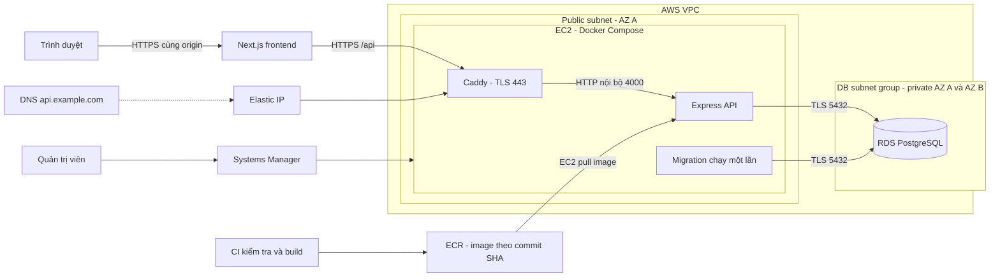

# Thiết kế triển khai backend Atelier lên AWS

## Phạm vi và lựa chọn

Thiết kế giai đoạn đầu dùng EC2 + Docker Compose cho Express, ECR cho image và RDS PostgreSQL cho dữ liệu. Frontend Next.js triển khai riêng, tiếp tục proxy `/api` tới backend. Giả định tải ban đầu thấp và chấp nhận downtime ngắn khi phát hành. Đây là phương án một máy; chưa cam kết SLA hay zero-downtime.

Region dự kiến: Singapore (`ap-southeast-1`). Account, domain, kích thước máy và ngân sách cần xác định trước khi tạo tài nguyên. Không có tài nguyên AWS nào được tạo bởi tài liệu này.

## Sơ đồ

Hai private subnet là yêu cầu bố trí DB subnet group; không có nghĩa DB đã bật Multi-AZ. Giai đoạn đầu có thể dùng Single-AZ với backup; bật Multi-AZ khi cần giảm gián đoạn do lỗi DB.

## Mạng và truy cập

VPC đề xuất `10.20.0.0/16`; public subnet AZ A `10.20.1.0/24`; private DB AZ A `10.20.11.0/24`, AZ B `10.20.12.0/24`. Public route table có default route tới Internet Gateway; private DB route table chỉ cần local route cho luồng ứng dụng. EC2 dùng Elastic IP để DNS ổn định và outbound tới ECR, SSM, CA provider, package repositories. Thiết kế này không cần NAT Gateway cho DB.

| Thành phần | Inbound | Ghi chú |
|---|---|---|
| EC2 security group | TCP 80/443 từ Internet | 80 phục vụ HTTPS redirect/challenge; không mở 4000 |
| RDS security group | TCP 5432 từ EC2 security group | Không dùng nguồn `0.0.0.0/0`; RDS public access tắt |
| Docker Express | 4000 từ mạng Compose | Không publish ra host trong cấu hình AWS |
| Quản trị EC2 | SSM qua outbound HTTPS | SSM Agent và IAM quyền quản trị node; không mở SSH mặc định |

Caddy là proxy trực tiếp trước Express, tương ứng `TRUST_PROXY_HOPS=1`. Frontend Next.js là upstream phía trước Caddy: trước khi dựa vào IP cho giới hạn đăng nhập, kiểm thử header chuyển tiếp thực tế. Nếu Next.js không truyền IP người dùng theo chuỗi tin cậy, Express có thể thấy IP của frontend; cần cấu hình proxy hoặc chuyển rate limit về lớp ingress. Không tăng hop tùy ý vì API có thể bị truy cập trực tiếp qua domain public.

## Runtime và dữ liệu

- EC2 x86_64, Docker và Compose v2. Đo CPU/RAM với tải thực để chọn instance; build image trên CI thay vì trên máy production.
- Image API chỉ chứa mã runtime và migration. Dùng tag commit SHA bất biến hoặc image digest; giữ vài release gần nhất trong ECR để rollback.
- RDS PostgreSQL tương thích schema hiện có, encryption at rest, backup tự động đề xuất 7 ngày và deletion protection. Lịch backup tránh giờ cao điểm. Thử restore vào DB riêng trước khi coi backup là khả dụng.
- `DATABASE_URL` dùng endpoint DNS RDS, `sslmode=verify-full` và RDS CA bundle. Không dùng IP thay endpoint certificate.
- Runtime user có quyền thao tác dữ liệu cần thiết; migration dùng user có quyền DDL riêng. Session lưu trong PostgreSQL nên restart backend không tự xóa phiên đăng nhập.
- Caddy lưu certificate trong Docker volume; sao lưu cấu hình host. Thay EC2 phải chuẩn bị lại `.env`, CA và volume/provision certificate.

## Secrets và IAM

Máy build dùng AWS SSO hoặc CI OIDC; quyền push giới hạn vào repository backend. EC2 dùng instance role có quyền pull ECR và quyền Systems Manager cần thiết. Nếu dùng Secrets Manager, cấp `GetSecretValue` chỉ cho secret được chỉ định và `kms:Decrypt` nếu secret dùng customer-managed KMS key.

Compose hiện đọc file `.env` quyền `600` trên EC2. Secrets Manager là hướng quản lý tập trung, chưa có tự động đồng bộ trong repo. Không đặt AWS key vào `.env`. Bootstrap admin credential chỉ dùng cho lệnh seed rồi bỏ khỏi môi trường runtime. Khi triển khai nhiều người dùng, tách file cấu hình runtime khỏi file credential migration/seed.

## Luồng phát hành

1. CI chạy kiểm tra source và integration tests với PostgreSQL tạm; kiểm tra image có thể build được.
2. Build image backend `linux/amd64`, scan, push ECR bằng SHA. Ghi lại image và schema version release trước.
3. Pull image mới trên EC2; xác minh CA, DNS và kết nối RDS. Chỉ một tiến trình phát hành được chạy tại một thời điểm.
4. Với migration ảnh hưởng writes: thông báo maintenance và dừng API. Backup theo mức rủi ro; chạy migration một lần, dừng phát hành nếu lỗi. Không seed lại mỗi release.
5. Cập nhật image, chạy `docker compose up -d --wait`. Docker restart policy xử lý process thoát; healthcheck không tự restart process chỉ vì readiness thất bại.
6. Kiểm tra HTTPS `/api/health`, `/api/ready` và luồng đăng nhập, tạo đơn, đăng xuất qua frontend. Chỉ kết thúc maintenance khi smoke tests đạt.
7. Khi lỗi app: quay về image cũ nếu schema tương thích. Khi lỗi migration/data: xử lý theo kế hoạch riêng; không tự động restore đè DB đang nhận writes.

CI hiện có trong `.github/workflows/ci.yml` mới thực hiện validation. Push ECR và deploy tự động chưa được cấu hình; có thể thực hiện theo runbook trước, sau đó tự động hóa bằng OIDC + SSM khi thông tin AWS đã chốt.

## Frontend, cookie và vận hành

Build Next.js với `API_INTERNAL_URL=https://api.example.com`; đặt `CLIENT_ORIGIN` bằng HTTPS origin frontend. Browser gọi `/api` cùng origin qua Next.js để giữ hành vi cookie hiện có. Test cả `Set-Cookie` và cookie chuyển tiếp ở môi trường deploy thực tế.

Mục tiêu giám sát: probe HTTPS readiness mỗi phút, báo lỗi sau ba lần thất bại; theo dõi 5xx, latency, disk EC2, CPU/RAM và RDS connections/storage. Đây là ngưỡng khởi đầu cần hiệu chỉnh theo tải, chưa phải CloudWatch alarms đã tạo. Compose hiện xoay vòng log cục bộ; bổ sung CloudWatch Agent hoặc log driver khi cần lưu tập trung, không ghi password/cookie/session token.

Để xem RDS bằng DBeaver từ Linux, dùng SSM port forwarding qua EC2 tới endpoint RDS. Giữ RDS private; không mở port DB ra Internet. SSL client vẫn cần xác minh đúng hostname RDS khi kết nối qua tunnel.

## Khi cần mở rộng

Nếu cần nhiều replica và phát hành ít gián đoạn, chuyển compute sang ECS Fargate sau ALB + ACM, private app subnets với outbound được thiết kế riêng. Dùng rate-limit store chung (ví dụ Redis), review trust proxy và giới hạn connection pool theo tổng số task; bật RDS Multi-AZ. Chi phí ALB, NAT/endpoints và Multi-AZ cần được tính trước khi chọn kiến trúc này.

## Hiện trạng bàn giao

Đã có: `compose.yml`, `Caddyfile`, `.env.example` và runbook `README.vi.md`. Chưa có: provisioning VPC/EC2/RDS bằng IaC, DNS thật, tài nguyên AWS, secret thật, pipeline phát hành AWS hay kiểm thử production. Các bước thực thi nằm trong [runbook](README.vi.md).

Tham chiếu: [RDS kết nối EC2](https://docs.aws.amazon.com/AmazonRDS/latest/UserGuide/ec2-rds-connect.html), [RDS security groups](https://docs.aws.amazon.com/AmazonRDS/latest/gettingstartedguide/security-groups.html), [Session Manager](https://docs.aws.amazon.com/systems-manager/latest/userguide/session-manager.html).
